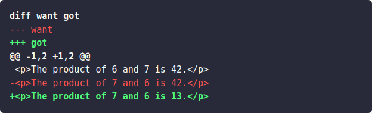

## Usage

The `strings.Diff` function returns an anchored diff of the two texts `OLD` and `NEW` in the unified diff format, using `OLDNAME` and `NEWNAME` as the labels in the diff header. If `OLD` and `NEW` are identical, the function returns an empty string.

## Examples

```go-html-template
{{ $want := `
<p>The product of 6 and 7 is 42.</p>
<p>The product of 7 and 6 is 42.</p>
` }}

{{ $got := `
<p>The product of 6 and 7 is 42.</p>
<p>The product of 7 and 6 is 13.</p>
` }}

{{ $diff := strings.Diff "want" $want "got" $got }}
{{ transform.Highlight $diff "diff" }}
```

The rendered output:


