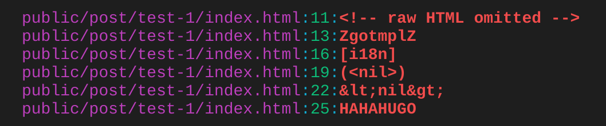

Some conditions produce errors in your published site that Hugo does not detect during the build. Run this command before your final build to find them.

```sh {copy=true}
HUGO_MINIFY_TDEWOLFF_HTML_KEEPCOMMENTS=true HUGO_ENABLEMISSINGTRANSLATIONPLACEHOLDERS=true hugo && grep -inorE "<\!-- raw HTML omitted -->|ZgotmplZ|\[i18n\]|\(<nil>\)|(&lt;nil&gt;)|hahahugo" public/
```

_Tested with GNU Bash 5.1 and GNU grep 3.7._

## Example output



## Explanation

The command above uses these environment variables, `grep` options, and patterns.

### Environment variables

`HUGO_MINIFY_TDEWOLFF_HTML_KEEPCOMMENTS=true`
: Retain HTML comments even if minification is enabled. This takes precedence over `minify.tdewolff.html.keepComments` in your project configuration. If you minify without keeping HTML comments, the audit cannot detect omitted raw HTML.

`HUGO_ENABLEMISSINGTRANSLATIONPLACEHOLDERS=true`
: Show a placeholder instead of the default value or an empty string when a translation is missing. This takes precedence over `enableMissingTranslationPlaceholders` in your project configuration.

### Grep options

`-i, --ignore-case`
: Ignore case distinctions in patterns and input data, so that characters that differ only in case match each other.

`-n, --line-number`
: Prefix each line of output with the 1-based line number within its input file.

`-o, --only-matching`
: Print only the matched, non-empty parts of a matching line, with each part on a separate output line.

`-r, --recursive`
: Read all files under each directory, recursively, following symbolic links only if they are on the command line.

`-E, --extended-regexp`
: Interpret patterns as extended regular expressions.

### Patterns

`<!-- raw HTML omitted -->`
: By default, Hugo removes raw HTML from your Markdown before rendering, and leaves this HTML comment in its place.

`ZgotmplZ`
: A special value that indicates that unsafe content reached a CSS or URL context at runtime, as described in the documentation for Go's [`html/template`][] package.

`[i18n]`
: The placeholder that Hugo renders instead of the default value or an empty string when a translation is missing.

`(<nil>)`
: The string that Hugo renders when you pass a `nil` value to the [`fmt.Printf`][] function.

`(&lt;nil&gt;)`
: The escaped form of the previous pattern. Hugo renders this string when you do not pass the value returned by the `fmt.Printf` function through the [`safe.HTML`][] function.

<!--
In the description below, do not remove &#x2060; (the Unicode Word Joiner)
from H&#x2060;AHAHUGOSHORTCODE. If you do, Hugo will throw this error when you build the project:

  illegal state in content; shortcode token missing end delim

Don't wrap the string in backticks either.
-->

`HAHAHUGO`
: Under certain conditions, a rendered shortcode may include all or part of the string H&#x2060;AHAHUGOSHORTCODE in uppercase or lowercase. This is difficult to detect in all cases, but a case-insensitive search of the output for `HAHAHUGO` is likely to find most of them without producing false positives.

[`fmt.Printf`]: /functions/fmt/printf/
[`html/template`]: https://pkg.go.dev/html/template
[`safe.HTML`]: /functions/safe/html/
